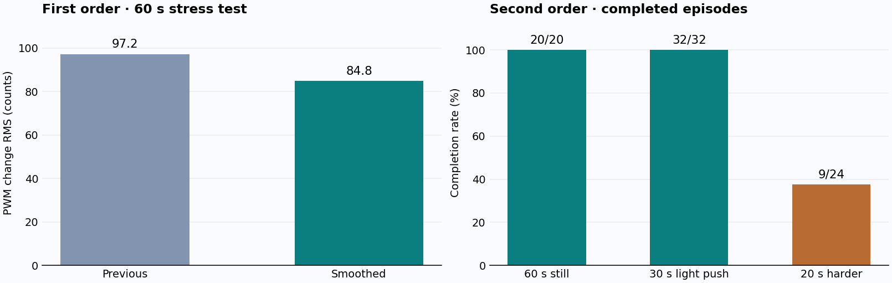
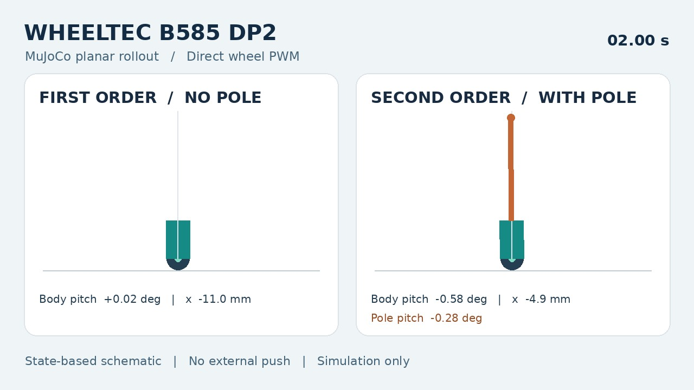
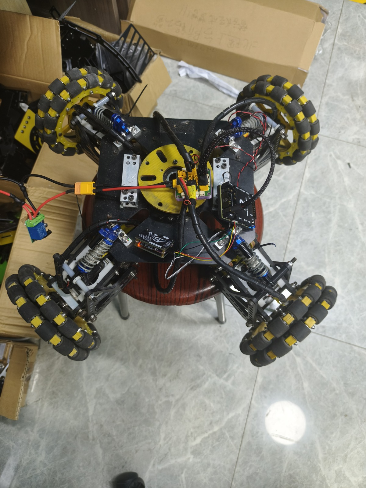
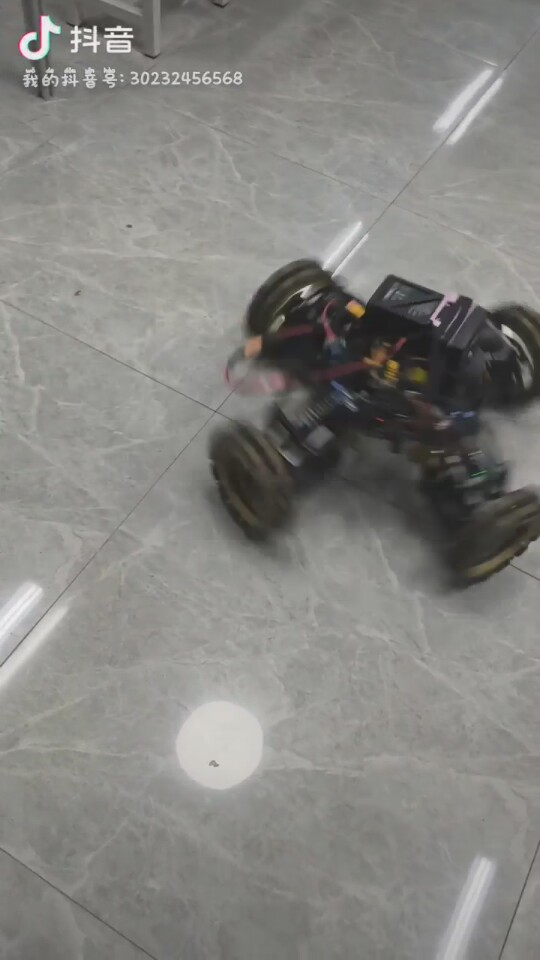
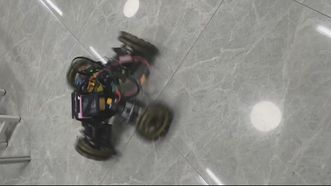

# WHEELTEC B585 DP2 · 纯强化学习平衡实验

在 MuJoCo 中训练两轮 DP2 原地站立。一阶使用拆杆车身，二阶保留摆杆，要求车身与摆杆同时保持直立。两个候选都直接输出左右轮 PWM。这里的结果来自平面仿真，实车闭环验收待完成。

| 策略 | 观测 → 动作 | 当前验证 |
| --- | --- | --- |
| [一阶无杆](models/first-order/policy.zip) | 6 → 2 | 60 秒强扰动，20/20 局完成。PWM 跳变 RMS 由 97.2 降至 84.8 |
| [二阶带杆](models/second-order/policy.zip) | 8 → 2 | 60 秒无推扰 20/20，30 秒轻推扰 32/32，20 秒较难工况 9/24 |

[完整训练日志](docs/TRAINING_LOG.md) · [媒体清单](docs/MEDIA.md) · [原始评估](results/)

## 仿真结果和演示



[](media/dp2-simulation.mp4)

这段视频使用仓库内的两个候选策略实跑，画面按仿真状态绘制。视频展示单次无推扰回合。多种子结果见评估日志。

## 实拍素材

<a href="media/chassis-photo.jpg"></a>
<a href="media/demo-vertical.mp4"></a>
<a href="media/demo-landscape.mp4"></a>

照片和两段实拍视频记录另一台四轮底盘。点击封面可查看照片或下载 MP4。[文件来源、尺寸和时长](docs/MEDIA.md)

## 载入模型并复评

使用 Python 3.10 和 CPU 版 PyTorch。MuJoCo 评估可在无显示器环境运行。

```bash
python3.10 -m venv .venv
source .venv/bin/activate
python -m pip install torch==2.9.1 --index-url https://download.pytorch.org/whl/cpu
python -m pip install -r requirements.txt
```

一阶需要与模型配套的归一化参数。以下是已记录的 20 局 60 秒强扰动评估。

```bash
python mujoco/train_direct_pwm_robust.py \
  models/first-order/policy.zip models/first-order/vecnormalize.pkl \
  --episodes 20 --seconds 60 --seed 99735 --scenario stress
```

二阶使用代码内固定观测缩放。以下复评 60 秒无推扰和 30 秒轻推扰两组。

```bash
python mujoco/train_second_order_pwm.py --model models/second-order/policy.zip \
  --level 0 --push 0 --seconds 60 --episodes 20 --seed 172781 \
  --pwm-limit 2500 --travel-limit 0.2
python mujoco/train_second_order_pwm.py --model models/second-order/policy.zip \
  --level 0 --push 0.08 --seconds 30 --episodes 32 --seed 172781 \
  --pwm-limit 4500 --travel-limit 0.2
```

继续训练时用 `--out` 指定新目录。训练和验证种子、回合终止规则、PWM 限值与当前取舍见 [训练日志](docs/TRAINING_LOG.md)。

## 仓库结构

| 路径 | 内容 |
| --- | --- |
| [mujoco/](mujoco/) | 两种结构的 MuJoCo 模型、环境、PPO 训练、平滑蒸馏和回报搜索 |
| [models/](models/) | 候选策略、一阶归一化参数和一阶对照检查点 |
| [results/](results/) | 完整评估 JSON 和保留的分支配置 |
| [docs/](docs/) | 训练经过、指标定义、实机边界及媒体来源 |
| [media/](media/) | 实拍素材、封面、仿真视频与成绩图 |
