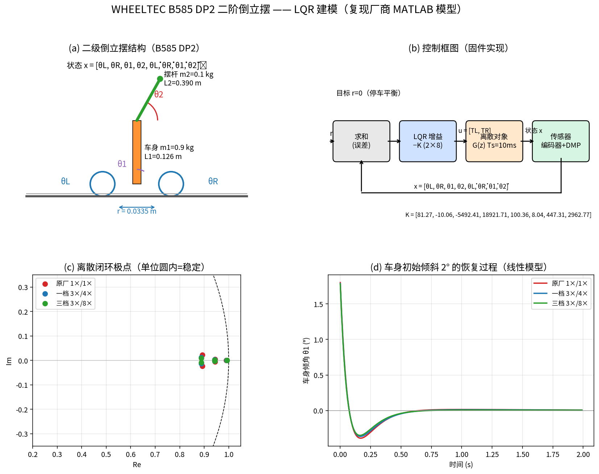

# LQR 建模与调参

`lqr_design.py`：按厂商模型（车身 m1=0.9 kg、摆杆 m2=0.1 kg、轮半径 0.0335 m、
L1=0.126 m、L2=0.390 m）组装 8 状态方程，按 10 ms 离散化，解离散 Riccati 方程求增益，
并与厂商 MATLAB `dlqr` 结果逐项对比。

```
状态顺序： [θL, θR, θ1, θ2, θ̇L, θ̇R, θ̇1, θ̇2]
权重：     Q = diag(51.2938, 51.2938, 32.8281, 131.3123, 51.2938, 51.2938, 131.3123, 131.3123)
           R = 0.0005 · I₂
```

脚本输出的增益与固件中写入的 `K11..K28` 完全一致；复算的闭环极点全部位于单位圆内。



调参记录、一阶（无杆）情形下把摆杆项置零的依据、以及"位置增益过大导致车轮对抗"的实测对比，
见 [LQR模型与调参说明.md](LQR模型与调参说明.md)。

```bash
python lqr/lqr_design.py
```
